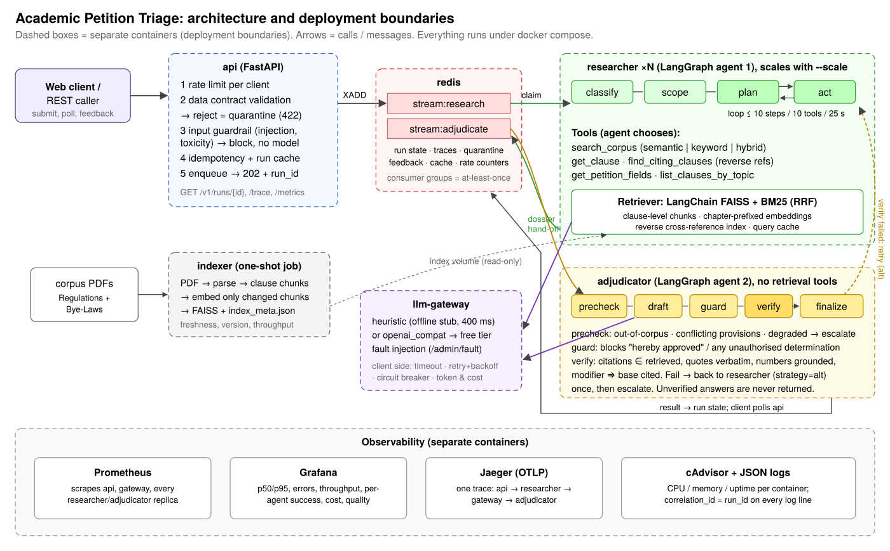

# Academic Petition Triage (Mini Project 15, UE24AM342AA5)

A multi-agent service that takes a **synthetic** student petition, validates it, finds every regulation that binds it
(including provisions that modify the base rule from another chapter), and returns a **cited, verified
recommendation**: grant-under-provision, refer-to-committee, reject-with-cited-clause, or escalate-to-human.
**It never decides.** The examination officer does.



## Run it (Docker, from a clean clone)
```bash
docker compose up --build
```
No `.env` is needed: compose reads `.env.example`, then `.env` if present. First start takes a few minutes (image
build). The `indexer` job builds the corpus PDFs and the FAISS index, then exits; everything else waits for it.

| URL | What |
|---|---|
| http://localhost:8000 | web client (presets for every demo case) |
| http://localhost:8000/docs | OpenAPI / REST interface |
| http://localhost:3000 | Grafana dashboard "Petition Triage" (anonymous view; admin password in `.env.example`) |
| http://localhost:16686 | Jaeger traces (service `api`) |
| http://localhost:9090 | Prometheus |
| http://localhost:8080/health | llm-gateway |

```bash
curl -s localhost:8000/ready                      # redis + index ready, queue depth
docker compose up -d --scale researcher=3         # scale the agent worker (A7)
```

## Try it
```bash
curl -s -X POST localhost:8000/v1/petitions -H 'content-type: application/json' -d '{
  "student_ref":"SYN-000123","program":"BTECH","admission_batch":2024,"semester":5,"course_code":"CS301",
  "submitted_on":"2026-11-01","declared_type":"attendance","grounds":"medical","classes_held":60,"classes_attended":41,
  "medical_certificate_attached":true,"days_since_resumption":3,
  "description":"I was hospitalised with dengue for two weeks and missed classes. Certificate attached."}'
# -> {"run_id":"run_...","status":"queued","status_url":"/v1/runs/run_..."}
curl -s localhost:8000/v1/runs/<run_id>           # poll until status=completed
curl -s localhost:8000/v1/runs/<run_id>/trace     # every tool call, query, passage, prompt version, latency, cost, verification
```

## Demonstration checklist (section 9)
```bash
pip install httpx && python scripts/demo.py      # runs items 2-8 and 10 against the running system, PASS/FAIL each
```
Inside Docker the researcher metrics are not published to the host. Run the demo from inside the network instead:
`docker compose exec api python scripts/demo.py --gateway http://llm-gateway:8080 --worker-metrics http://researcher:9100`.

| # | Item | How |
|---|---|---|
| 1 | clean clone → working system | `docker compose up --build` |
| 2 | valid request, citations resolve | web client "4.1 hard case" / demo item 2 |
| 3 | run traced end to end | `/v1/runs/{id}/trace`, the web client trace table, Jaeger |
| 4 | malformed → quarantined, no run | "Malformed" preset; `GET /v1/quarantine` |
| 5 | outside corpus → escalation | "Out of corpus" preset |
| 6 | verification catches unsupported answer | `curl -X POST localhost:8080/admin/fault -d '{"mode":"hallucinate","count":1}' -H 'content-type: application/json'`, then submit |
| 7 | prompt injection | "Prompt injection" preset; output filter: fault mode `rogue` |
| 8 | circuit breaker + degradation | fault mode `error`, submit 3 petitions, watch the Grafana "Circuit breaker" stat; reset with mode `none` |
| 9 | Locust vs SLO, --scale | see "Load test" |
| 10 | section 4.1 case | "4.1 hard case" preset |

## Evaluation (L2, L3)
```bash
docker compose run --rm -e LLM_BASE_URL=inprocess://heuristic api python -m app.eval.run_eval --compare-strategy single_pass agentic
docker compose run --rm -e LLM_BASE_URL=inprocess://heuristic api python -m app.eval.run_eval --compare-prompts v1 v2
```
Results and metric definitions: [docs/evaluation.md](docs/evaluation.md). Scenarios: `eval/scenarios.jsonl` (29).

## Load test (D6, A7, D7)
SLO declared in [docs/slo.md](docs/slo.md) **before** measuring. Results: [docs/loadtest_results.md](docs/loadtest_results.md).
```bash
docker compose --profile loadtest up locust       # UI at http://localhost:8089, host is preset to http://api:8000
# headless matrix (from the host, with Python + locust installed):
python loadtest/run_matrix.py --label r1 --users 5,10,20,40
docker compose up -d --scale researcher=3 && python loadtest/run_matrix.py --label r3 --users 5,10,20,40
python scripts/cost_report.py                     # cost per 100 runs + largest cost driver (needs redis port; see below)
```
To run `run_matrix.py` / `cost_report.py` against Docker, add `ports: ["6379:6379"]` to the redis service.

## Using a real LLM (free tier)
Create `.env` (git-ignored):
```
GATEWAY_PROVIDER=openai_compat
GATEWAY_UPSTREAM_URL=<your provider's OpenAI-compatible base URL>
LLM_MODEL=<model id>
LLM_API_KEY=<key>
```
`docker compose up -d llm-gateway`. Agents are unchanged; prompts in `prompts/` are sent as-is. Set a spending limit first.

## Using your university's real regulations
1. Put the PDFs in `corpus/raw/` and list them in `corpus/corpus.yaml` (code REG/BYE, title, version, scope).
2. If clause numbering differs from `3.1 Heading. Text`, adjust `CLAUSE_RE` / `CHAPTER_RE` in `app/corpus/pipeline.py`.
3. Remove the `synth` step from the indexer command in `docker-compose.yml`. Rebuild the index: `docker compose run --rm indexer`.
4. Update `eval/scenarios.jsonl` gold clauses (`python eval/build_scenarios.py` is the template).

## Without Docker (development)
```bash
pip install -r requirements.txt     # plus a local redis-server
scripts/dev_up.sh 1                 # gateway, api, 1 researcher, adjudicator; scripts/dev_down.sh to stop
python -m pytest -q tests
```

## Repository map
| Path | Contents |
|---|---|
| `app/api` | FastAPI service: contract validation, quarantine, guardrails, cache, rate limit, runs, trace, feedback |
| `app/agents` | researcher + adjudicator LangGraph graphs, tools, verifier, conflict detector, trace recorder |
| `app/gateway` | llm-gateway service, offline provider (`heuristic.py`, `rules.py`), fault injection |
| `app/corpus` | PDF generator, indexing pipeline (CLI), embedder, retriever |
| `app/worker` | queue consumers for both agent roles |
| `app/eval` | metrics and batch evaluation CLI |
| `app/contracts.py` · `app/guardrails.py` · `app/resilience.py` · `app/llm_client.py` | data contract, L4, A5, model client |
| `prompts/` | versioned prompts (L2) |
| `contracts/` | JSON Schemas |
| `docs/` | architecture, data contract, SLO, load test, evaluation, **runbook**, **incident log**, report |
| `eval/` | evaluation set and results |
| `loadtest/` | Locust file and matrix runner |
| `observability/` | Prometheus config, Grafana provisioning and dashboard |
| `.env.example` | every configuration variable, documented |
