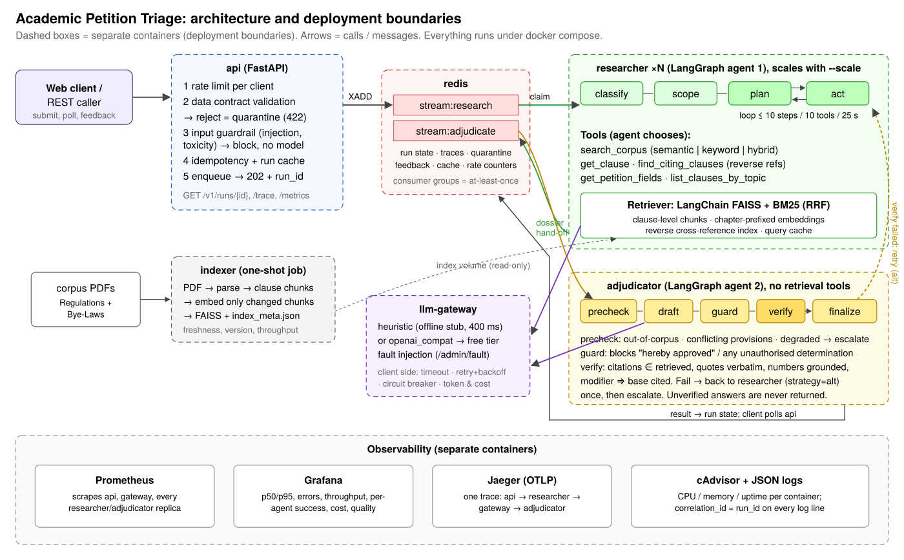

# Architecture

## Request lifecycle
1. **api** checks the per-client rate limit, then validates the body against the data contract (`app/contracts.py`):
   schema, type, range, category and cross-field rules. A reject is **quarantined** with field-level errors and HTTP 422.
   No run id is created and nothing is enqueued.
2. The input guardrail scans every free-text field. On prompt injection or a threat, the run is closed immediately as
   `escalate-to-human` (`guardrail`). The text never reaches a model.
3. Idempotency key and whole-run cache are checked. Otherwise the run is created and a message is added to
   `stream:research`. The api returns **202 + run_id** at once.
4. A **researcher** claims the message, classifies the petition, checks corpus scope, then runs the bounded tool loop.
   It writes a *dossier* (every passage it retrieved, with its own observations) to the run and enqueues `stream:adjudicate`.
5. An **adjudicator** claims it: precheck (out of corpus / conflicting provisions / degraded) → draft → output guard →
   **verify**. If verification passes it finalises. If it fails, it sends the run back to the researcher with
   `strategy=alt` and the verifier's feedback (once). After that it escalates.
6. The client polls `GET /v1/runs/{id}`. `GET /v1/runs/{id}/trace` reconstructs the whole run.

## Agents (A2)
| | researcher | adjudicator |
|---|---|---|
| Responsibility | find **every** binding provision | turn evidence into a cited, verified position and route |
| Graph | classify → scope → (plan ⇄ act)* | precheck → draft → guard → verify → finalize / hand back |
| Model calls | classify, research_plan (per step) | draft_position |
| Tools | 5 retrieval/lookup tools | none (it can only judge what it was handed) |
| Process | `researcher` service, scaled | `adjudicator` service |
| Hand-off | dossier in Redis + message on `stream:adjudicate` | result in Redis, or message back on `stream:research` |

**If one fails mid-run:** messages are only ACKed after the agent's output is written. A crashed worker's message stays
pending in the consumer group and is re-claimed by another replica after `QUEUE_CLAIM_IDLE_S`. Both agent tasks are
idempotent: they overwrite the dossier/result for that run. This was tested by `kill -9` on a researcher mid-run; the
run completed on the other replica and the trace shows a `redelivered` event. After `QUEUE_MAX_DELIVERIES`, or past
`RUN_DEADLINE_S`, the run is closed as `failed` with an escalation, never as an answer. If the *provider* fails, the
breaker opens and each agent takes the degradation path (below).

## Why it is an agent, not a pipeline (section 5)
The researcher decides what to call next from what it has read:
1. retrieve the provision that appears to apply (`search_corpus`);
2. ask whether anything modifies it: `find_citing_clauses(base)` (reverse references: which clauses say
   "Notwithstanding Clause 3.1"), then
3. search again with a query **derived from the base clause text** plus the petition's facts, not the petition wording;
4. follow forward references, check the Bye-Laws for the same subject, and fetch the precedence clause when two
   documents give different limits;
5. the adjudicator **verifies**; on failure the researcher retries with a **different strategy** (enumerate the topic
   exhaustively + keyword search), and if that still fails the run escalates.

Loop bounds: `AGENT_MAX_STEPS=10`, `AGENT_MAX_TOOL_CALLS=10`, `AGENT_MAX_WALL_S=25` per research round, plus a run
deadline. Every model call has a timeout.

## Chunking and embedding (L1): how it addresses the corpus difficulty
* **One chunk per numbered clause.** That is the unit a decision is cited at, and clauses never split. Each chunk keeps
  doc, chapter number and title, clause id, heading, page, topic tags and forward references.
* **Embedded text is prefixed** with the document and chapter title (`Academic Regulations 2024 | Chapter 7: Special
  Provisions | 7.4 Condonation of Shortfall in Attendance …`), so a late-chapter modifier still carries its subject.
* **Reverse cross-reference index** built at load. The base rule (3.1) never mentions the condonation clause, but
  the condonation clause says "Notwithstanding Clause 3.1". `find_citing_clauses("REG-3.1")` returns REG-3.4 and
  REG-7.4 directly. This is the structural fix for "the provision is stated elsewhere, often without a cross-reference".
* **Hybrid retrieval:** dense (LangChain FAISS, inner product) + BM25, fused with reciprocal-rank fusion. Exact numbers
  and legal terms ("65%", "condoned") are matched lexically; paraphrases are matched densely.
* **Re-embedding without a rebuild:** each chunk stores a content hash and the embedding-model id. The pipeline only
  embeds new or changed chunks (FAISS `delete` + `add_embeddings`). `--reembed REG-7.4` forces individual chunks.
  Changing the model id re-embeds everything.
* **Embedding backends:** `sentence-transformers` (set `EMBEDDING_MODEL`, build with `INSTALL_ST=1`) or `hashing`
  (stateless hashed uni+bigrams, works offline, which is why a clean clone needs no model download). Measured effect:
  with hashing, a pure semantic search for the 4.1 petition misses both 3.1 and 7.4; hybrid finds 7.4 but not 3.1;
  the agent's base query + reverse reference finds both.

## Verification (A3)
`app/agents/verifier.py`, deterministic, applied to **every** returned answer including escalations:
`citations_resolve_to_retrieved` · `quotes_verbatim` · `mentioned_clauses_cited` · `numbers_grounded` (every number is
in a cited clause or the petition, or derived from them) · `modifier_and_base_both_cited` · `route_supported_by_cited_text`
· `committee_named_in_citation` · `escalation_reason_present`.

## Resilience (A5)
Timeout per model call (`LLM_TIMEOUT_S`) and per tool call (`TOOL_TIMEOUT_S`). Bounded retry with full-jitter
exponential backoff, honouring `Retry-After` on 429. Per-process **circuit breaker** (closed → open after 4 failures →
half-open after 15 s → one probe). **Fallback path:** the classifier falls back to keyword rules; the research loop falls
back to a fixed 3-step retrieval pipeline; the adjudicator returns *evidence only*, routed `escalate-to-human` with
`degraded: true`. Degraded results are never cached. All of it can be demonstrated with `POST llm-gateway/admin/fault`.

## Deployment boundaries (D3): why these services are separate
| Service | Scaling | Failure isolation | Independent release | Resource profile |
|---|---|---|---|---|
| api | by request rate; stateless | a slow agent can't block submissions | contract/guardrail changes | light CPU |
| researcher | **the scaled unit** (bottleneck) | crash only affects in-flight research; re-claimed | retrieval/prompt changes | holds FAISS index in RAM; I/O-bound |
| adjudicator | rarely (1 model call/run) | verification bug can't corrupt retrieval | verifier/draft changes | light |
| llm-gateway | single choke point to the provider | provider faults contained; breaker on callers | swap provider by config | network-bound |
| indexer | batch job | index rebuild can't take down serving | corpus updates | CPU burst, then exits |
| redis | n/a | persistent queue; work survives worker restarts | n/a | memory |

**Rejected alternatives:** a single process running both agents (fails the "two prompts in one process" rule, and a
crash takes out both); Celery (another broker abstraction over the Redis Streams we already need for state); webhooks
instead of polling (the caller needs a public endpoint, and callbacks are an SSRF risk; polling is simpler to
demonstrate); an LLM judge for verification (it would ask a model to grade a model, at extra cost and with
non-determinism); a cross-encoder re-ranker (needs a model download, and the reverse-reference tool solved the
actual failure).

## Why polling (A4)
Runs take 4-15 s. Holding an HTTP request open that long ties up connections and breaks behind proxies. Callbacks
require the caller to expose a URL (SSRF risk, and our caller is a browser). Polling a cheap `GET` every 250-500 ms is
simple, idempotent and works from the web client. The **queue** (Redis Streams) between submission and execution
absorbs bursts and lets researchers scale independently.
